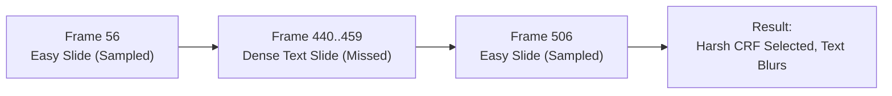
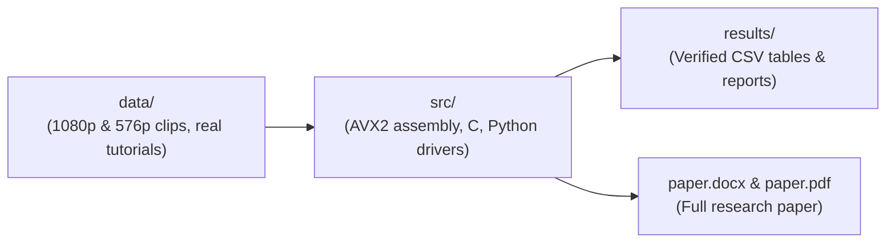

# Cut-Driven Settled-Frame Sampling and Per-Segment CRF Zoning for Screen-Content Video

**Authors:** Juan Miguel Miranda, Jean Khladyn Stefanie Abarquez, and Kimberly Klaire Gamboa  
**Department of Computer Technology, De La Salle University**  
*Advanced Computer Architecture (CSC612M) Research Project / QoMEX Submission*  

## Overview and Core Idea

Screen recordings such as lecture presentations, code tutorials, and software walk-throughs consist mostly of static images interrupted by short bursts of dense text. In our study clips, a 30-second video (900 frames at 30 fps) shows a simple background slide for most of the duration, with a dense text slide appearing for only 20 frames (about 0.67 seconds).

When compressing video, we select a Constant Rate Factor (CRF):
- Higher CRF (stronger compression): Produces smaller files, but text becomes blurry and unreadable.
- Lower CRF (gentler compression): Produces larger files, but preserves crisp text readability.

Measuring full-reference VMAF across all 900 frames at every candidate CRF is slow. Industry tools (such as `ab-av1` and FFmpeg `libvmaf:n_subsample`) take a fast shortcut: they inspect only 8 sample frames across the video and pick the highest CRF where all 8 frames score at least VMAF 90.



### Why Standard Spot Checks Fail

1. **Evenly Spaced Uniform Sampling (Industry Baseline):** Places 8 samples 112 frames apart. A 20-frame text slide falls between sample points and is missed 100% of the time. The encoder selects an overly aggressive CRF that degrades the text.
2. **Settled Cut-Driven Sampling (Our Approach):** We first run a fast AVX2 assembly scanner to find the exact frame where the screen changes. We wait 8 frames (about 0.25 seconds) for the new slide to settle, then take our 8 samples directly from the text hold (`cut+8 .. cut+15`). This detects the text complexity and picks a safe CRF.
3. **Cut-Driven Per-Segment Zoning (`x264 --zones`):** Applying a safe CRF to the entire file wastes bits on simple slides. Using our detected cut timestamps, we assign each segment its own minimum-passing CRF in a single encode, keeping text sharp while shrinking file size.

---

## Complete Project Structure



### 1. `src/` (Active Codebase)
- [`src/sad_scalar.c`](src/sad_scalar.c): Baseline C pixel-by-pixel Sum of Absolute Differences.
- [`src/sad_avx2.s`](src/sad_avx2.s): Hand-written x86-64 AVX2 assembly using `vpsadbw` (32 pixels per instruction).
- [`src/detect.c`](src/detect.c): Streams consecutive frame pairs through both kernels, verifies zero mismatches, and outputs cut frame indices.
- [`src/time_kernel.c`](src/time_kernel.c): Measures kernel execution times across in-memory frame pairs.
- [`src/config.py`](src/config.py): Discovers FFmpeg, GCC, and system fonts across macOS and Windows.
- [`src/run_timing.py`](src/run_timing.py): Runs kernel timing benchmarks and writes `results/1_kernel_timing.csv`.
- [`src/run_study.py`](src/run_study.py): Evaluates selector rules and zoning across the 1080p and 576p suites.
- [`src/run_codecs.py`](src/run_codecs.py): Compares selector behavior across H.264 (`x264`), HEVC (`x265`), and AV1 (`SVT-AV1`).
- [`src/run_real_clips.py`](src/run_real_clips.py): Evaluates 5 unscripted real-world Wikimedia tutorials totaling 30,695 frames.
- [`src/build_paper_doc.py`](src/build_paper_doc.py): Generates `paper.docx` and `paper.pdf` directly on the machine.

### 2. `results/` (Generated Experimental Data)
- [`results/1_kernel_timing.csv`](results/1_kernel_timing.csv): Kernel runtimes and speedups.
- [`results/2_selector_decisions.csv`](results/2_selector_decisions.csv): 5-selector decisions on the 23-clip 576p suite.
- [`results/2a_decisions_1080p.csv`](results/2a_decisions_1080p.csv): 5-selector decisions on the 18-clip 1080p suite.
- [`results/3_zoning_summary.csv`](results/3_zoning_summary.csv): Multi-cut cycle and zoning results.
- [`results/4_side_by_side_comparison.csv`](results/4_side_by_side_comparison.csv): Clip-by-clip side-by-side comparison on 1080p.
- [`results/5_multicodec_comparison.csv`](results/5_multicodec_comparison.csv): Multi-codec comparison on `x264`, `x265`, and `SVT-AV1`.
- [`results/6_real_world_recordings.csv`](results/6_real_world_recordings.csv): Results across the 5 real-world screencasts.
- [`results/REPORT.md`](results/REPORT.md): Summary analysis of the full study.

### 3. `data/` (Static Assets and Pre-Computed Scores)
- `data/clips_1080p/`: Decisions and full 900-frame VMAF logs for the 18 Full-HD clips.
- `data/slides_1080p/`: 1080p simple, medium, and dense test slides.
- `data/clips/`: 576p screen clips, camera controls, and dissolve tests.
- `data/real_clips/`: Manifest and metadata for the 5 real-world screencast tutorials.
- `data/zoning/`: Summary logs for rapid-cycle and 1080p60 tutorials.

### 4. `references/` (Literature)
- [`references/notes.md`](references/notes.md): Annotated bibliography of all 8 cited academic papers and industry references.
- Verified reference PDFs.

---

## Summary of Results

### 1. AVX2 Cut Scanner Speedup (899 Full-HD 1080p Frame Pairs)
- Scalar C (`-O0`): `1.0216 s` (`1136.4 us/pair`).
- Auto-vectorized C (`gcc -O2`): `0.4493 s` (`499.8 us/pair`, `2.27x` speedup).
- Hand-written AVX2 (`sad_avx2.s`): `0.1551 s` (`172.5 us/pair`, `6.59x` speedup, `0` mismatches).
- Compared to one full 900-frame 1080p VMAF pass (`21.16 s`), our AVX2 scan is **136.4x faster**.

### 2. Five 8-Frame Sampling Strategies (18 Full-HD 1080p Clips, Target VMAF 90)
- **Uniform (`libvmaf:n_subsample=112`):** `0 / 18` text hits. Fails target quality on `12 / 18` clips (`10.32` mean shortfall).
- **Random (1,000 draws/clip):** `18.6%` text hit rate. Fails on `11 / 18` clips (`8.39` mean shortfall).
- **Naive On-the-Cut (`cut..cut+7`):** Fails to find a passing CRF on `6 / 18` clips (`33.3%` failure rate) due to `0.0` VMAF transition spikes.
- **Spatial Variance (Top-8 variance):** Fooled on `8 / 12` clips (`10.13` shortfall) by dark background slides.
- **Settled Cut-Driven (`cut+8..cut+15`, Ours):** Passes `18 / 18` clips (`100%`) with **`0.00` shortfall**.

### 3. Multi-Codec Evaluation (`x264`, `x265`, `SVT-AV1`)
- **H.264 (`x264`):** Uniform has `10.59` mean shortfall (`0 / 4` pass). Settled achieves `0.00` shortfall (`4 / 4` pass).
- **HEVC (`x265`):** Uniform has `8.50` mean shortfall (`0 / 4` pass). Settled achieves `0.00` shortfall (`4 / 4` pass).
- **AV1 (`SVT-AV1`):** Uniform has `1.56` mean shortfall (`1 / 4` pass). Settled achieves `0.00` shortfall (`4 / 4` pass) at `140.3 KB` average size.

### 4. Five Real-World Screencast Tutorials (30,695 Frames)
- Screen stillness check: `93.0%` of frame pairs show absolute luma difference <= 2.
- Worst-frame quality: Cut-driven zoning raises 1st-percentile VMAF from `74.35` to `83.40` (**`+9.05` VMAF improvement**).
- Bitrate savings: Cut-driven zoning saves **`10.6%` in file size on average** compared to global settled encoding.

---

## Research Paper Documents

The complete research paper is compiled in the repository root:
- Word Document: [`paper.docx`](paper.docx) (openable in Microsoft Word, Pages, and Google Docs).
- PDF Document: [`paper.pdf`](paper.pdf) (formatted 3-page research paper with tables and references).
- HTML Source: [`paper.html`](paper.html).

To rebuild the paper documents at any time:
```zsh
python3 src/build_paper_doc.py
```
