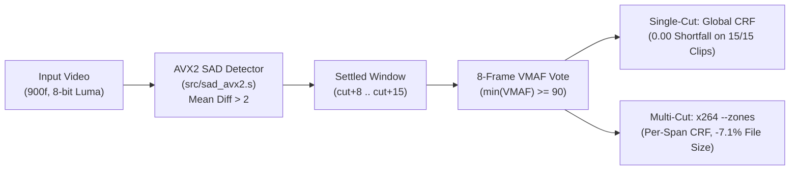

# Cut-Driven Frame Sampling and Per-Segment CRF Selection for Screen-Content Video

Screen recordings (lectures, slides, and software tutorials) typically consist of long static stretches interrupted by brief, high-detail text slides. Standard fast quality checks—such as probing 8 evenly spaced frames across a clip or pooling full-file VMAF at the 5th percentile—systematically miss short text holds (e.g., 20 frames in a 900-frame clip). Consequently, the encoder selects an overly aggressive Constant Rate Factor (CRF) that blurs fine text while still passing the sparse probe.

This project implements a two-part solution:
1. **Data-Parallel Scene-Cut Detection (Course Track):** Computes frame-to-frame Sum of Absolute Differences (SAD) on 8-bit luma planes in x86-64 AVX2 assembly (`vpsadbw`, 32 pixels/instruction), achieving a **6.6x–7.8x speedup** over scalar C with zero mask mismatches.
2. **Settled-Frame Sampling & Per-Segment Zoning (Paper Track):** Waits 8 frames after each detected cut (`cut+8 .. cut+15`) before sampling 8 frames to select the highest CRF meeting target VMAF (`>= 90` or `>= 80`). For multi-cut videos, detected boundaries drive per-segment `x264 --zones` so complex text segments receive protective bitrates without bloating simple slides.

---

## End-to-End Pipeline



---

## Repository Structure

```text
CSC612M-Paper/
├── src/                           # Core C, x86-64 AVX2 Assembly, and Python drivers
│   ├── sad_scalar.c               # Scalar C baseline SAD kernel
│   ├── sad_avx2.s                 # Hand-written x86-64 AVX2 SAD kernel (vpsadbw + scalar tail)
│   ├── detect.c                   # Streaming frame-pair cut detector (verifies 0 mismatches)
│   ├── time_kernel.c              # QueryPerformanceCounter 5-pass benchmark harness
│   ├── detect.exe                 # Compiled Windows x86-64 detector binary
│   ├── time_kernel.exe            # Compiled Windows x86-64 timing binary
│   ├── config.py                  # Cross-platform path discovery (FFmpeg, MinGW GCC, Tesseract)
│   ├── run_timing.py              # Runs/exports the kernel timing benchmark
│   └── run_study.py               # Evaluates all 5 selectors, ablations, OCR, and x264 zoning
├── data/                          # Input slide assets and cached 900-frame VMAF/OCR logs
│   ├── slides/                    # Source slide and natural-image boundary PNGs
│   ├── clips/                     # Per-clip 900-frame VMAF JSON logs across the CRF ladder
│   ├── scenecut/                  # Condition B (x264 scene-cut enabled) VMAF logs
│   ├── ocr/                       # Tesseract OCR character-recall cache on text holds
│   └── zoning/                    # Multi-segment (4-span and 44-span cycle) VMAF logs
├── results/                       # Generated CSV tables and study report
│   ├── 1_kernel_timing.csv        # Scalar C vs. Auto-Vectorized C vs. AVX2 Assembly timings
│   ├── 2_selector_decisions.csv   # Per-clip results across 5 selectors at VMAF 90 & 80
│   └── 3_zoning_summary.csv       # Per-segment x264 --zones quality and bitrate results
└── references/                    # Background literature and reference PDFs
```

---

## How to Run

### Prerequisites
- **Python 3.13+** with `pillow` and `imageio-ffmpeg` (`pip install pillow imageio-ffmpeg`)
- **Windows:** MinGW-w64 GCC (`x86_64-w64-mingw32-gcc`) and Tesseract OCR (optional, cached logs included)
- **macOS (Apple Silicon):** Runs the Windows x86-64 AVX2 binaries directly via Rosetta 2 + Wine

### 1. Run the AVX2 vs. Scalar C Timing Benchmark
```bash
# Export timing table from cached hardware run:
python src/run_timing.py

# Or synthesize a 900-frame raw stream and execute 5 live timing passes:
python src/run_timing.py --live
```

### 2. Run the 5-Selector & Per-Segment Zoning Study
```bash
python src/run_study.py
```
This evaluates all five 8-frame selectors (`Settled`, `Evenly Spread`, `Random`, `On-the-Cut`, and `High-Detail`) at **VMAF 90** and **VMAF 80**, computes 10,000-resample bootstrap confidence intervals on the 1st-percentile (9th-worst frame) shortfall, and writes [`results/2_selector_decisions.csv`](results/2_selector_decisions.csv) and [`results/3_zoning_summary.csv`](results/3_zoning_summary.csv).
