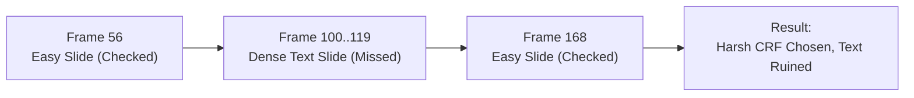
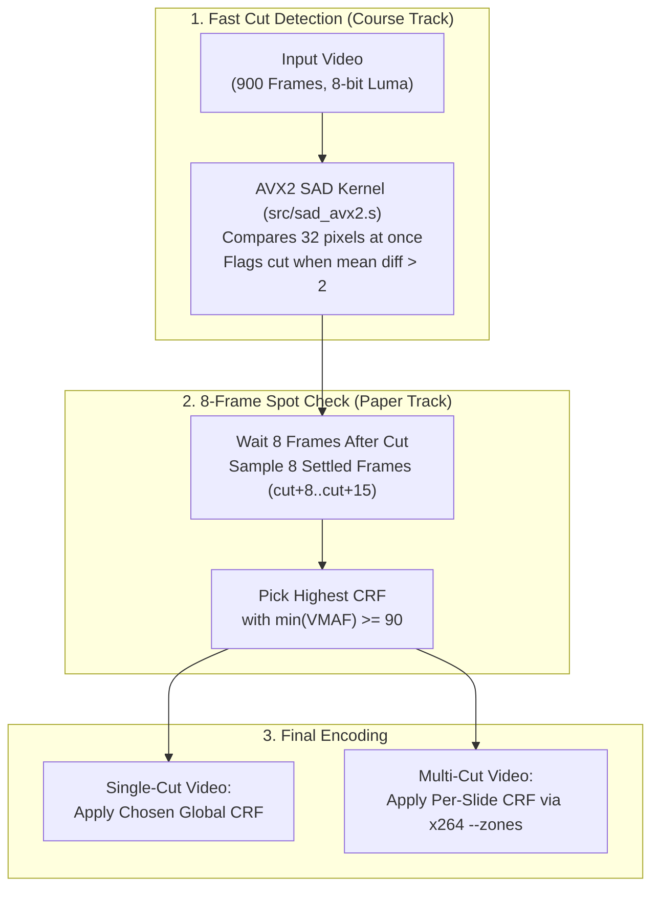
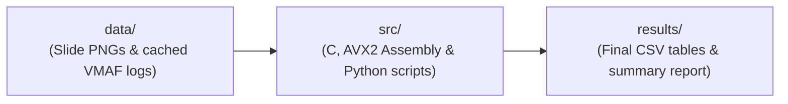

# Cut-Driven Frame Sampling and Per-Segment CRF Selection for Screen-Content Video

## Overview and Core Idea

Screen recordings (such as lecture captures, slide presentations, and software tutorials) usually consist of long static stretches interrupted by brief, high-detail text slides. In our study, a 30-second clip (900 frames at 30 fps) mostly shows a simple slide, with a dense text page appearing for only 20 frames (about two-thirds of a second).

When compressing a video with `x264`, we must select a Constant Rate Factor (CRF) to control compression strength:
- **Higher CRF (stronger compression):** Produces a smaller file, but fine text becomes blurry and unreadable.
- **Lower CRF (gentler compression):** Produces a larger file, but keeps fine text sharp.

Scoring all 900 frames with VMAF at every candidate CRF is computationally expensive. A common fast shortcut is to evaluate only **8 sample frames (8 spot checks)** across the 900-frame clip and pick the highest CRF where all 8 frames score at least VMAF 90.



### Why Standard Spot Checks Fail

1. **Evenly Spaced Sampling (Old Baseline):** Picks 8 frames at equal intervals across the 900-frame clip (frames 56, 168, 281, 393, 506, 618, 731, and 843). Because the 8 samples sit 112 frames apart, a 20-frame text slide falls completely between two samples. All 8 spot checks land on the easy background slide, tricking the selector into picking a harsh CRF that ruins the text.
2. **Cut-Driven Settled Sampling (Our Approach):** Instead of sampling blindly, we first run a fast frame-difference scanner to detect the exact frame where the screen changes. We wait 8 frames (about 0.25 seconds) for the new slide to settle, then take our 8 spot checks directly from that new slide (`cut+8 .. cut+15`). Because the 8 spot checks now land on the dense text, the selector chooses a gentler CRF that preserves text readability.
3. **Cut-Driven Per-Segment Zoning (`x264 --zones`):** On videos with multiple slide changes, applying a gentle CRF to the entire file wastes bits on blank slides. Using our detected cut boundaries, we assign each segment its own minimum-passing CRF in a single `x264 --zones` encode, keeping text sharp while reducing overall file size.

---

## End-to-End Pipeline



---

## Repository Guide

All active source code lives inside `src/`. The remaining folders store pre-computed inputs (`data/`), generated output tables (`results/`), and cited literature (`references/`).



### 1. `src/` (Active Codebase)

**C and x86-64 AVX2 Assembly (Scene-Cut Detector and Benchmark)**
- [`src/sad_scalar.c`](src/sad_scalar.c): Baseline C implementation that computes the Sum of Absolute Differences (SAD) between consecutive frames one pixel at a time.
- [`src/sad_avx2.s`](src/sad_avx2.s): Hand-written x86-64 AVX2 assembly implementation using `vpsadbw` to process 32 pixels per instruction, followed by a scalar tail loop.
- [`src/detect.c`](src/detect.c): Streams consecutive frame pairs through both `sad_scalar` and `sad_avx2`, verifies zero mismatches between them, and outputs the detected scene-cut frame indices.
- [`src/time_kernel.c`](src/time_kernel.c): Uses `QueryPerformanceCounter` to time 5 in-memory passes of the scalar C, compiler auto-vectorized C, and hand-written AVX2 assembly kernels.
- `src/detect.exe` and `src/time_kernel.exe`: Pre-compiled Windows x86-64 binaries built from the sources above.

**Python Experiment Drivers**
- [`src/run_timing.py`](src/run_timing.py): Runs the kernel benchmark and exports the timing comparison table to `results/1_kernel_timing.csv`.
- [`src/run_study.py`](src/run_study.py): Evaluates all five 8-frame sampling rules (`Settled`, `Evenly Spread`, `Random`, `On-the-Cut`, and `High-Detail`) at targets VMAF 90 and VMAF 80, computes 10,000-resample bootstrap confidence intervals, evaluates OCR text recall, and summarizes the per-segment zoning experiments.
- [`src/config.py`](src/config.py): Automatically locates FFmpeg, MinGW-w64 GCC, Tesseract OCR, and system fonts across Windows and macOS environments.

### 2. `results/` (Generated Tables for the Paper and Course Report)
- [`results/1_kernel_timing.csv`](results/1_kernel_timing.csv): Kernel execution times, throughput (MPix/s), speedups (6.6x to 7.8x for AVX2 over scalar C), and mismatch counts (`0`).
- [`results/2_selector_decisions.csv`](results/2_selector_decisions.csv): Per-clip CRF decisions, 1st-percentile (9th-worst frame) VMAF shortfalls at targets 90 and 80, 5th-percentile (45th-worst frame) scores, and file sizes across all 23 test clips.
- [`results/3_zoning_summary.csv`](results/3_zoning_summary.csv): Per-segment CRF choices, worst-frame VMAF, and file-size savings for the 4-segment and 44-segment `x264 --zones` experiments.

### 3. `data/` (Static Inputs and Cached Quality Logs)
Full 900-frame VMAF evaluations across all CRF rungs are pre-computed and stored here as JSON logs so `src/run_study.py` can recompute all selector votes in a few seconds without re-encoding videos from scratch:
- `data/slides/`: Source slide PNGs and natural boundary images (`cat`, `gravel`, `leaves`).
- `data/clips/`: Per-clip 900-frame VMAF JSON logs for the 15 screen clips, 3 hold-duration ablations, and 3 boundary clips.
- `data/scenecut/`: VMAF logs with `x264` scene-cut detection enabled.
- `data/ocr/`: Cached Tesseract OCR text recognition outputs on the 20-frame text holds.
- `data/zoning/`: Cached VMAF logs and summaries for the multi-segment zoning experiments.

### 4. `references/` (Literature)
- Contains the reference PDFs and reading notes cited in our proposal and paper.

---

## Summary of Main Results

### 1. AVX2 vs. Scalar C Kernel Timing (899 Frame Pairs, 1024x576)

| Kernel Implementation | Median Time (s) | Speedup vs. Scalar C | Mask Mismatches |
| :--- | :---: | :---: | :---: |
| `plain_c` (Scalar C) | `1.021557` | `1.00x` | `0` |
| `autovectorized_c` (Compiler `-O3 -mavx2`) | `0.449318` | `2.27x` | `0` |
| `avx2_asm` (Hand-written `sad_avx2.s`) | `0.155129` | **`6.59x`** | `0` |

### 2. Five 8-Frame Sampling Rules on 15 Screen Clips

Shortfall measures how far the chosen file's 1st-percentile VMAF (9th-worst frame out of 900) falls below the target (lower is better; `0.00` means the clip met the target).

| 8-Frame Selector Rule | Mean Shortfall (Target 90) | Clips Passing 90 | Mean Shortfall (Target 80) | Clips Passing 80 |
| :--- | :---: | :---: | :---: | :---: |
| **Settled Frames (`cut+8..cut+15`) [Ours]** | **`0.00`** | **`15 / 15`** | **`0.00`** | **`15 / 15`** |
| Evenly Spread Frames (8 bin centers) | `12.22` | `0 / 15` | `17.77` | `1 / 15` |
| Seeded Random Frames (8 random) | `10.79` | `2 / 15` | N/A | N/A |
| On-the-Cut Frames (`cut..cut+7`) | `0.00` | `15 / 15` | N/A | N/A |
| High-Detail Frames (top 8 luma variance) | `0.00` | `15 / 15` | N/A | N/A |

### 3. Cut-Driven Per-Segment Zoning (`x264 --zones`)

| Multi-Cut Experiment | Harsh / First-Slide Global CRF | Gentle Global CRF (Text-Safe) | Cut-Driven Zoned (`x264 --zones`) |
| :--- | :---: | :---: | :---: |
| **4-Segment Clip (480 frames, 3 cuts)** | `64,935 B` (Text VMAF drops to `51.56`) | `192,568 B` (All spans >= 90) | **`184,159 B`** (All spans >= 90, saves 4.4%) |
| **44-Segment Cycle Clip (880 frames, 43 cuts)** | `403,836 B` (1st-pct VMAF drops to `36.52`) | `1,929,745 B` (1st-pct VMAF `90.27`) | **`1,793,543 B`** (1st-pct VMAF `90.27`, **saves 136 KB / 7.1%**) |

---

## How to Run

### Windows (Native with Python 3.13 and MinGW-w64 GCC)
```powershell
python src/run_timing.py          # Export cached hardware timing table (or pass --live to run 5 passes)
python src/run_study.py           # Run the full 5-selector and zoning study
```

### macOS Apple Silicon (via Rosetta 2, Wine, and Homebrew Python 3.13)
```zsh
/opt/homebrew/bin/python3.13 src/run_timing.py
/opt/homebrew/bin/python3.13 src/run_study.py
```
